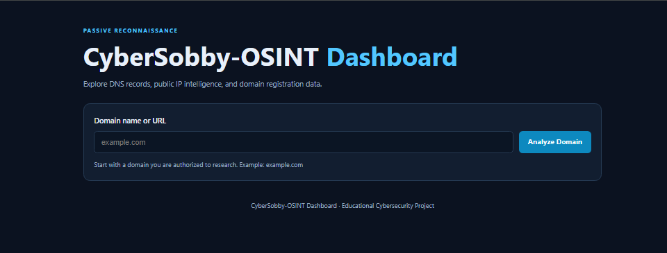
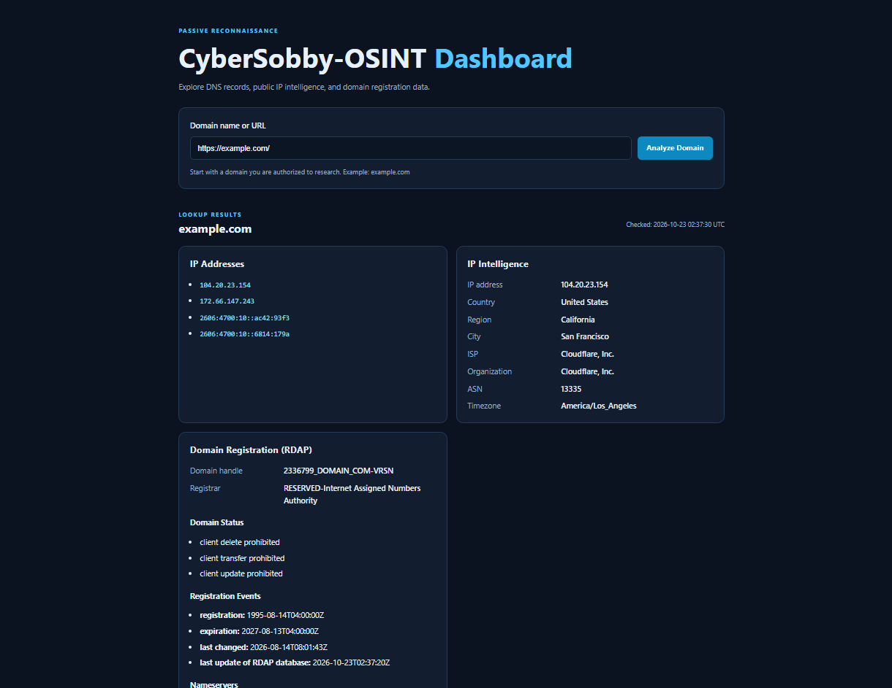
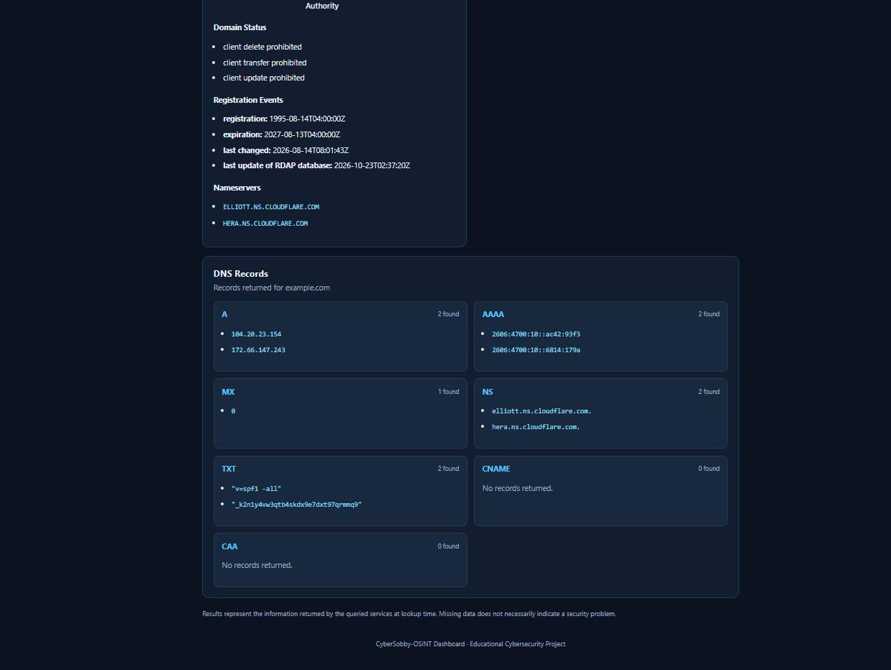

OSINT Dashboard

A Python-based Open-Source Intelligence (OSINT) Dashboard that collects and displays publicly available information about a domain. The application provides a simple web interface for looking up DNS records, resolving public IP addresses, retrieving IP intelligence, and viewing domain registration information.

This project was built as a hands-on cybersecurity learning project to explore DNS, public information sources, API integration, and web application development.

## Screenshots 

### Main Interface

### Example Basic Scan

Features

DNS Record Lookup

Retrieve common DNS records for a domain, including:

A: IPv4 addresses associated with the domain.

AAAA: IPv6 addresses associated with the domain.

MX: Mail servers responsible for receiving email.

NS: Authoritative nameservers associated with the domain.

TXT: Text records commonly used for domain verification and email security configurations.

CNAME: Canonical name records that point a name to another hostname.

CAA: Certificate Authority Authorization records that specify which certificate authorities may issue certificates for a domain.

Public IP Intelligence

The dashboard extracts publicly routable IP addresses from DNS results and uses the IP intelligence service ipwho.is to retrieve available information, such as:

IP address and address type

Country, region, and city

Internet service provider (ISP)

Network organization

Autonomous System Number (ASN)

Time zone

IP information is requested for the first eligible public IP address returned by the DNS lookup.

Domain Registration Information

The application uses the Registration Data Access Protocol (RDAP) to retrieve publicly available domain registration information.

Depending on the domain and the data returned by the service, results may include:

Domain registration handle

Registrar name

Domain status codes

Registration-related events and dates

Nameservers

Registration information may be redacted, incomplete, or unavailable for some domains.

Web Interface

Additional functionality includes:

Domain and URL input handling

Basic domain validation

Organized DNS, IP intelligence, and registration panels

Error handling for common lookup failures

Lookup timestamps

Technology Stack

Technology

Purpose

Python

Application logic and information processing

Flask

Web application framework

dnspython

DNS record lookups

Requests

HTTP requests to public data services

HTML

Dashboard structure

CSS

Layout, styling, and responsive design

RDAP

Domain registration data retrieval

ipwho.is

IP intelligence and geolocation data

How It Works

The user enters a domain name or URL into the dashboard.

The application extracts and validates the domain.

DNS queries retrieve available A, AAAA, MX, NS, TXT, CNAME, and CAA records.

Publicly routable IP addresses are extracted from the DNS results.

The IP intelligence service is queried for one eligible IP address.

The application requests domain registration data through RDAP.

Flask passes the collected results to the HTML template, where the dashboard displays them in organized sections.

The application relies on public DNS and external data services. Results therefore depend on network connectivity, the information published for the domain, and the availability of each service.

Project Structure

OSINT-Dashboard/
├── app.py
├── requirements.txt
├── templates/
│   └── index.html
└── static/
    └── style.css

app.py — Flask application, input validation, DNS lookups, and external data requests.

requirements.txt — Python package dependencies.

templates/index.html — Dashboard layout and results display.

static/style.css — Dashboard styling and responsive layout.

Installation and Setup

Prerequisites

Python 3.10 or newer recommended

pip

An internet connection

Visual Studio Code or another Python editor

1. Clone the Repository

git clone https://github.com/cybersobby-maker/OSINT-Dashboard.git
cd OSINT-Dashboard

Replace YOUR-USERNAME with your GitHub username and use your actual repository name.

Alternatively, download the repository as a ZIP file and extract it.

2. Create a Virtual Environment

On Windows, run:

python -m venv .venv

Activate the environment:

.venv\Scripts\Activate.ps1

If you use Windows Command Prompt instead of PowerShell:

.venv\Scripts\activate.bat

3. Install Dependencies

python -m pip install -r requirements.txt

If you need to install the dependencies manually:

python -m pip install Flask dnspython requests

4. Start the Application

Run:

python app.py

5. Open the Dashboard

Open the following address in your browser:

http://127.0.0.1:5000

Enter a domain name, such as example.com, and select Analyze Domain to view the available results.

Example Use Cases

Inspect publicly available DNS records for a domain.

Identify public IP addresses associated with a hostname.

Review approximate IP geolocation and network organization information.

Examine available domain registration details.

Learn how DNS resolution and external information services can support passive reconnaissance.

Limitations

Data availability: Not every domain publishes every DNS record type.

IP geolocation: City and region information is approximate and does not reliably identify an individual's physical location.

Shared infrastructure: Content delivery networks and shared hosting can cause multiple domains to resolve to the same infrastructure.

External services: IP intelligence and RDAP lookups may fail because of rate limits, timeouts, service outages, or unavailable data.

Registration privacy: Some registration details may be redacted or omitted.

DNS variability: Results can differ based on the configured resolver, caching, DNS propagation, and network conditions.

Security assessment: This tool collects basic public information; it does not determine whether a domain is safe, malicious, or vulnerable.

An empty result or missing data does not automatically indicate suspicious activity.

Privacy and Responsible Use

This project is intended for education and authorized cybersecurity research using publicly available information.

Only investigate domains for legitimate purposes.

Respect the terms and usage limits of external data services.

Avoid submitting confidential information through the dashboard.

Understand that domain lookups and external API requests may be visible to DNS resolvers and the services receiving those requests.

Keep the Flask development server local unless the application has been appropriately secured for deployment.

The dashboard does not need a paid API key for its basic DNS and RDAP functionality. Its IP intelligence feature uses the public ipwho.is service, which is subject to that service's current terms and limits.

Future Improvements

Potential enhancements include:

Exporting lookup results to JSON.

Saving lookup history using SQLite.

Adding DNS-over-HTTPS resolver options.

Improving validation and automated test coverage.

Adding source links and clearer error diagnostics.

Providing downloadable investigation reports.

Adding optional integrations with threat-intelligence services.

Learning Outcomes

Building this project provides hands-on practice with:

DNS records and hostname resolution

Public IP addressing and basic network intelligence

RDAP and domain registration data

Python and HTTP API integration

Flask routes and Jinja templates

Input validation and exception handling

Presenting technical information in a web interface

Disclaimer

This application is an educational OSINT project. The information it displays comes from public DNS responses and external services and may be incomplete or inaccurate. It should not be treated as a substitute for a comprehensive security assessment.

License

This project is available for educational and portfolio use. Add a LICENSE file to the repository if you wish to publish it under a specific open-source license.